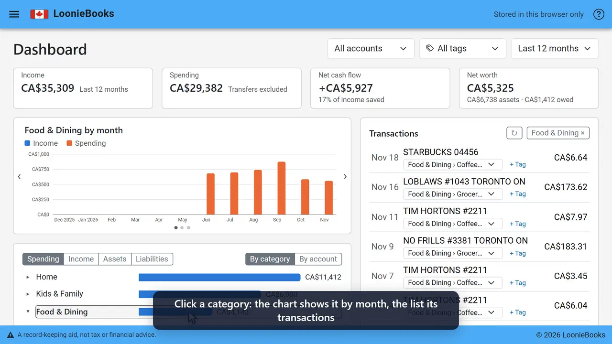

# LoonieBooks

A personal finance tracker for Canadians, in the spirit of Mint before it lost bank sync:
see where your money goes, income vs spending over time, net worth across accounts, and a
year-end **tax report** that gathers the transactions behind your deductions and credits.

It is built on the **FDX (Financial Data Exchange)** data model so it can connect to banks through
Canada's consumer-driven banking (open banking) APIs once they are available. Until then, you get
your data in by **copying transactions from your bank's website and pasting them in**.



## Try it

- **In your browser**, on any computer: [demo.looniebooks.ca](https://demo.looniebooks.ca/).
  Nothing to install and no account. *Explore a sample household* fills it with a made-up family's year to look
  around in, or start your own: your ledger stays in that browser (see
  [Where your data lives](#where-your-data-lives)); back it up from *Your data*.
- **On Windows**: download `LoonieBooks.zip` from the
  [latest release](https://github.com/savagepanda/LoonieBooks/releases/latest), unzip it anywhere and
  run `LoonieBooks.exe`. It needs no .NET and no sign-in, keeps your ledger in a file on your PC, and
  can share it with your household's devices at home (see [Desktop app](#desktop-app)).

  The app isn't code-signed yet, so Windows may say *Windows protected your PC*. Choose
  **More info**, then **Run anyway**. Each release lists the zip's SHA-256 checksum; to check your
  download, run `Get-FileHash LoonieBooks.zip` in PowerShell and compare.

LoonieBooks is a record-keeping aid with CRA line references, not tax or financial advice, and it
comes with no warranty (see [License](#license)). Release news, what's coming and questions:
[r/looniebooks](https://www.reddit.com/r/looniebooks/) on Reddit. Found a problem? [Open an issue](https://github.com/savagepanda/LoonieBooks/issues);
for security problems, see [SECURITY.md](SECURITY.md).

## Where your data lives

**Your ledger stays with you.** There is no LoonieBooks cloud service and no accounts held by the
project: your finances are kept on your own devices, or on a server you run yourself.

| How you run it | Ledger stored in | Notes |
|---|---|---|
| [Desktop app](#desktop-app) (recommended) | **A SQLite file on your PC** (`%LOCALAPPDATA%\MapleLedger\ledger.db`), or the browser | LoonieBooks looks after the file. You can share it with your household's phones and computers on your home network. |
| Any LoonieBooks site, not signed in, or the [static site](#static-site) | **This browser**: SQLite on the Origin Private File System | Never sent to the server. Back it up from *Your data*. |
| [Your own server](#self-hosting) | **That server's database** (SQL Server), for the accounts you allow | Follows you across devices. You decide who signs in and who may store a ledger there (see [Server storage](#server-storage)). |

A ledger kept in the browser can be copied into the desktop app's database or your own server from
**Your data**.

### Remote access (idea, not built yet)

If LoonieBooks ever offers a paid tier, the plan is a Plex-style model: the project would help you
reach and share **your own** LoonieBooks (the desktop app or your server) from outside your home
network, for example by giving it an address and passing encrypted traffic through to it, while the
ledger itself stays on your hardware. Nothing like this exists today; outside your network, use a
tunnel or VPN you control.

## Features

- **Paste import.** Select the transaction table on any Canadian bank site, copy, paste. The parser
  handles copied HTML tables (tab-separated), CSV exports, tables that paste as one cell per line,
  and statement-style text. It works out date, description, amount/withdrawal/deposit and balance
  columns. It reads English and French dates and amounts (`Sep 28, 2026`, `28 sept. 2026`,
  `1 234,56 $`, `(12.00)`, `12.00 CR`), and it uses the running balance to settle money-in vs
  money-out when amounts have no sign. You can correct any column before importing. Parsing always
  runs in the browser.
- **PDF statements.** Choose one or more downloaded statements on the Import page. PdfPig reads them
  in the browser (`PdfStatementReader`), and the reader rebuilds the transaction table from where the
  words sit on the page: amounts line up in columns by their right edges, dates printed once per day
  are carried forward, wrapped descriptions are joined, and dates without a year take it from the
  statement's own period. A box beside the table (a card statement's payment information) is kept
  out of its rows: table cells share their row's baseline exactly, the box's lines don't. Pages
  printed with alternating margins are lined up by their date column. The result goes into the
  paste box as a table for the normal parser, so you
  can check and edit it. Statements encrypted only to restrict editing (they open without a
  password, like TD's RC4 and BMO's AES-128) are decrypted first by `PdfDecryptor`, which has its
  own MD5, RC4 and AES because .NET has neither MD5 nor AES in the browser. Scanned (image-only),
  password-protected and AES-256-encrypted PDFs can't be read.
- **CSV exports.** The same file picker takes the CSV files banks offer as downloads. They go to the
  paste parser as-is (`CsvStatementReader`), decoded as UTF-8, UTF-16 or Windows-1252. Several files
  (e.g. one per month) are joined into one table, keeping only the first file's header.
- **Pictures of statements.** The Import page also takes pictures: capture the bank's window or tab
  from the screen, photograph a paper statement with the webcam or a phone (the same one-time QR
  code as the receipt scanner), choose image files, or paste a screenshot with Ctrl+V. Tesseract.js
  reads them in the browser in sparse-text mode (so lone dates and amounts aren't skipped),
  straightening photos first, and `PdfStatementReader.ReadWords` rebuilds the table from the words'
  positions as it does for PDFs. Each picture is read on its own, since each has its own scale, and
  their columns are lined up by where they sit across the table. OCR can misread a character, so the
  page asks you to check amounts before importing.
- **Safe re-imports.** Each pasted transaction gets a stable id, so pasting an overlapping date
  range skips what's already there.
- **Possible duplicates.** The same statement imported from two files (a PDF and a CSV that print
  "NORTHERN SHIELD INSU HALIFAX" and "NORTHERN SHIELD INSU") gets different ids. The dashboard,
  Transactions and Import pages flag pairs with the same account, direction and amount, at most
  3 days apart, with look-alike descriptions (identical ones from one import are real repeats).
  The review page merges a pair, moving receipts, category and tax choices onto the copy kept, or
  keeps both so they aren't flagged again. "Keep both" isn't part of backups.
- **Undo an import.** The Import page lists recent imports into the selected account (and offers
  Undo right after importing). Undo removes the transactions that import added, with any receipts
  attached to them; ones it skipped as duplicates stay. The account balance isn't changed back.
- **Start over.** Your data → Start over deletes the whole ledger in the current storage (browser or
  database) after you type DELETE, offering a backup download first.
- **Same merchant, same category.** Changing a transaction's category offers the account's other
  transactions from the same merchant (same words, ignoring store numbers and reference codes) in
  a dialog; tick the ones to change too.
- **Categorization** with Canadian merchant rules, in two levels: a category (Income, Auto &
  Transport, Taxes…) and an optional detail (Salary, Gas, Property Tax…), picked from a two-column
  panel with a search box. Add your own categories and details from that panel or the Categories page (new
  top-level categories count as spending). Transfers and card payments are excluded from income and spending, and refunds reduce
  spending instead of counting as income.
- **Remembered choices and review.** An import gives each transaction the category you last chose
  for the same merchant (in that account, else any account), ahead of the built-in rules, and the
  tags on that merchant's newest transaction in the account; the preview marks them *remembered*.
  Automatic categories (rules or remembered) need review until you change them or confirm them with
  ✓; filter Transactions by **Category review** and confirm a whole list at once.
- **Tags.** Labels like *Rental* or *Cottage* that group transactions across categories and
  accounts; a transaction can have several. Built-in tags (Business, Home Office, Moving,
  Reimbursable, Renovation, Rental, Shared, Vacation) work like built-in categories; add your own
  from a transaction's **+ Tag** (on the Transactions page and the dashboard panel: search, or type
  a new name) or on the Tags page (rename, delete, counts). Tag a whole filtered list at once on
  the Transactions page. The dashboard and the transaction list filter by any of the picked tags; the
  dashboard's totals then cover only those transactions (net worth stays whole). Tags travel in
  backups, matched by name on restore.
- **Dashboard.** Income, spending, net cash flow, net worth, monthly income vs spending, and
  spending and income by top-level category, each expandable (one at a time) into its details.
  Clicking a month or category shows its transactions beside the chart, with a link to the full list.
  Totals are in Canadian dollars: income and spending in accounts kept in other currencies are
  converted at the Bank of Canada's monthly average rate for their month (its Valet `FXM…CAD` series,
  fetched by the browser and saved in the ledger's `MonthlyExchangeRates`), or the latest rate for the
  month under way.
- **Budget.** A yearly budget per spending category or detail (`Budgets` table, one row per year and
  line, in backups), suggested from last calendar year's spending or, without a whole year yet, the
  latest complete months counted as a year, rounded up. The Budget page shows amounts per month or per
  year beside last year's budget and this year's spending. A line can be yearly-only (no monthly
  share), suggested for spending that comes in a few months; categories under 1% of spending sit under
  Other. The dashboard's *Budget vs spending by month* chart shows each month against a twelfth of the
  budget, for the whole household or one category; *Budget status* shows each category against its
  monthly budget for a month, or its whole budget for the year so far. The maths is `BudgetCalculator` in `MapleLedger.Core`.
- **Investment holdings.** Investment accounts keep a snapshot of what they hold (symbol, units,
  price, market and book value) from the broker's holdings report, CSV or pasted, rather than every
  trade: trades inside an account aren't spending or income. Each import replaces the snapshot and
  sets the account balance to its total. Each account is in CAD or USD (holdings that don't state a
  currency are in it), and other-currency holdings are valued at one ledger-wide rate per currency:
  the Bank of Canada's daily rate, fetched by the browser from its Valet API (only the currency code
  is sent), or one the user types. A new rate revalues the holdings and balances that were their
  total. Every account's balance is in its own currency (set on Accounts); net worth and the
  Accounts totals convert at these rates. Changing an account's currency moves the holdings that
  were in the old one to the new one. Between statements, listed stocks and ETFs are priced from
  stocktreemap.com's public quote feed (`QuoteFeed`, `QuoteSymbols`): the browser downloads the
  whole feed (about 80 KB compressed) and looks the holdings up locally, so nothing about the
  ledger is sent. A new price sets the holding's market value to quantity × price, and balances
  that were their holdings' total follow, as with exchange rates. `Quotes:FeedUrl` in the client's
  `wwwroot/appsettings.json` points it elsewhere, and an empty value turns it off. Net worth by month
  moves the holdings by their listings' month-end closes from stocktreemap.com's monthly price
  history feed (`PriceHistoryFeed`, `StockTreeMapHistory`, `HoldingPriceMoves`): one shared list of
  every symbol (about 22 KB compressed) and one file per ended month with every listing's close in
  the list's order (about 20 KB). The browser downloads only the months the chart shows that a
  holding still needs, picks out its holdings' closes locally and saves them (`ApplyPriceHistoryAsync`),
  so nothing about the ledger is sent and a month isn't downloaded twice. `PriceHistory:BaseUrl`
  points it elsewhere, and an empty value turns it off. The page shows one account at a time. Headers
  are matched by name across brokers, and reports covering several accounts (Wealthsimple) are
  filtered to one, showing only the last 4 digits of account numbers.
- **Real estate.** Properties (on Accounts) have a value, the date it's from, a city or area, and the
  loans secured by them, for equity and loan-to-value. A property's value is carried by its area's
  CREA MLS® Home Price Index from ownquity.com's public feed (`HpiFeed`, `OwnquityHpi`): the browser
  downloads every region's monthly index since 2005 (about 70 KB compressed), finds the property's
  region from its city locally, and saves that region's months as the area's index readings
  (`ApplyHpiAsync`), so nothing about the properties is sent. Values move by the index's change since
  their month, forward to today and back through net worth by month. `HousePriceIndex:FeedUrl` in the
  client's `wwwroot/appsettings.json` points it elsewhere, and an empty value turns it off.
- **Tax report.** Each transaction can carry a tax tag (medical expenses line 33099, charitable
  donations 34900, child care 21400, RRSP 20800, FHSA 20805, union dues 21200, moving 21900,
  carrying charges 22100, employment T777, self-employment T2125, rental T776, and more). Likely
  candidates are suggested on import; you confirm or reject them, then export a CSV. *This is a
  record-keeping aid, not tax advice.*
- **Backups.** Download the whole ledger as one file, and restore it into any browser, the desktop
  app or your own server.
- **Help.** `/help` holds an article for every part of the app, searchable and grouped by task,
  and the ? button in the top bar opens the current page's article in a dialog. Articles are Razor
  components in `MapleLedger.Web.Client/Help`, listed in `HelpCatalog` (which also maps each page
  to its article); `help?a=<id>` opens one, `help?q=<words>` starts with a search. Short silent clips
  of the main tasks, filmed from a made-up ledger, sit in the articles.

## Architecture

```
Browser (Blazor WebAssembly)
  ├─ ILedgerStore ── BrowserLedgerStore ── LedgerService ── EF Core ── SQLite (OPFS, Web Worker)
  └─ ILedgerStore ── ServerLedgerStore ──► ledger-web ──(signed user token)──► ledger-api ── LedgerService ── EF Core ── SQL Server
                                            Google sign-in,                       JWT validation,
                                            cookie, YARP forwarding               storage check, per-user rows
```

Both stores run the same `LedgerService` (in `MapleLedger.Data`), so every feature works the same
whether the ledger is in the browser or in a database. The desktop app runs the same two hosts on
your PC, with a SQLite file in place of SQL Server.

| Project | Purpose |
|---|---|
| `MapleLedger.AppHost` | .NET Aspire orchestration; publishes to Docker Compose |
| `MapleLedger.ServiceDefaults` | OpenTelemetry, health checks, resilience; the internal API token contract |
| `MapleLedger.Fdx` | FDX Accounts/Transactions contract types (wire-compatible JSON) |
| `MapleLedger.Core` | Paste parser, categorizer, cash-flow and tax reports |
| `MapleLedger.Data` | EF Core model, `LedgerService`, browser (SQLite) migrations |
| `MapleLedger.ApiService` | Minimal API for ledgers kept in a database: `/fdx/v6/*` (FDX-shaped) and `/api/*`; SQL Server migrations. With `Database:Provider=Sqlite` (the desktop app) it uses a SQLite file and the browser's migrations |
| `MapleLedger.Web` / `.Web.Client` | Blazor Web App host (sign-in, API forwarding) and the WebAssembly UI |
| `MapleLedger.Desktop` | Windows launcher (`LoonieBooks.exe`) that runs the web host and API locally; see [Desktop app](#desktop-app) |
| `MapleLedger.UnitTests` | Parser, categorization, report, ledger and migration tests |
| `MapleLedger.Tests` | Aspire integration tests, including the security boundary |

### Security model

- The **API is never exposed**. The browser only talks to `ledger-web`.
- `ledger-web` signs users in with Google (cookie auth). It forwards `/api` and `/fdx` only for
  signed-in users. It strips the browser's cookies and attaches a 2-minute token signed with a key
  it shares with the API.
- `ledger-api` rejects any request without a valid token. It serves ledger endpoints only to
  users allowed server storage (the `Premium` tier in the code), and scopes every query and write to the signed-in user (`OwnerId`, enforced by
  EF query filters and on save). A context with no owner sees nothing and can't save.
- State-changing API calls also need an `X-MapleLedger` header, so a cross-site page can't forge them.
- Only the last four digits of an account number are ever stored. Raw pasted text and uploaded PDFs never leave the browser.

### FDX and Canadian open banking

Accounts and transactions are stored as FDX records (`accountId`, `accountCategory`,
`debitCreditMemo`, `postedTimestamp`, …), and the API exposes them at `/fdx/v6/accounts` and
`/fdx/v6/accounts/{id}/transactions`. A future FDX data provider (a bank, or an accredited
aggregator) can therefore feed the same tables without translation.

Canada's *Consumer-Driven Banking Act* received Royal Assent in March 2026, with the Bank of Canada
as regulator. Draft regulations, including technical standards, were published for comment in
June 2026. The models here follow FDX's published structure and should be checked field by field
against the official FDX OpenAPI specification before connecting to a live provider.

## Running locally

Requirements:

- .NET 10 SDK
- The **.NET WebAssembly build tools**, needed because browser SQLite relinks the WebAssembly
  runtime. From an **elevated** terminal:
  ```bash
  dotnet workload install wasm-tools
  ```
- SQL Server (the local default instance with Windows authentication), used for server storage.

```bash
dotnet run --project MapleLedger.AppHost
```

Without any further setup everyone is anonymous and their ledger is kept in the browser.

### Google sign-in (optional locally)

1. In the [Google Cloud console](https://console.cloud.google.com/apis/credentials), create an
   OAuth client (type: Web application). Add the redirect URI `https://localhost:7022/signin-google`,
   plus `https://<your hostname>/signin-google` for the deployed site.
2. Store the credentials in the AppHost's user secrets:
   ```bash
   dotnet user-secrets --project MapleLedger.AppHost set Parameters:google-client-id "<client id>"
   ```
   ```bash
   dotnet user-secrets --project MapleLedger.AppHost set Parameters:google-client-secret "<client secret>"
   ```

### Server storage

On a server you run, signing in alone keeps the ledger in the browser. A signed-in user may store
their ledger in the server's database if their row in the `Users` table has `Tier = 'Premium'` (the
code's name for this permission; it isn't a paid plan), or if their email is in the
`premium-emails` list (comma separated), which grants it on sign-in:

```bash
dotnet user-secrets --project MapleLedger.AppHost set Parameters:premium-emails "you@example.com"
```

Users appear in `Users` the first time they sign in. To grant it by hand:
`UPDATE Users SET Tier = 'Premium' WHERE Email = '...'`.

### Tests

```bash
dotnet test --project MapleLedger.UnitTests
```

```bash
dotnet test --project MapleLedger.Tests
```

The integration tests start the whole app against the local SQL Server, using a separate
`MapleLedgerTests` database.

### Database migrations

There are two migration sets for the one model. Add a migration to both when the model changes;
a unit test fails if either falls behind.

```bash
dotnet ef migrations add <Name> --project MapleLedger.ApiService --output-dir Data/Migrations --namespace MapleLedger.ApiService.Data.Migrations
```

```bash
dotnet ef migrations add <Name> --project MapleLedger.Data --output-dir Migrations/Sqlite --namespace MapleLedger.Data.Migrations.Sqlite
```

Server migrations apply on API startup (`Database__MigrateOnStartup=false` to opt out). Browser
migrations apply when the app opens.

## Desktop app

A Windows app you start by double-clicking `LoonieBooks.exe` and stop by closing its window (or keep
running in the notification area: see *Closing the window* below).
It needs no .NET, no Docker and no sign-in.

```bash
desktopbuild.bat
```

This publishes a self-contained win-x64 folder to `artifacts\desktop\LoonieBooks` and zips it as
`artifacts\desktop\LoonieBooks.zip` (the build machine needs `wasm-tools`). If LoonieBooks is
running from that folder, the script closes it first and starts the new build when it's done. To
install on another PC, unzip it anywhere and run `LoonieBooks.exe`.

**Upgrading to a new version** needs no other steps:

1. Unzip the new `LoonieBooks.zip` anywhere: beside the old copy (say, a new folder), or over it
   once its window is closed (Windows can't replace the files of a running program).
2. Open the new `LoonieBooks.exe`. If an older copy is still open (even hidden in the notification
   area), the new one stops it and takes over; opening an *older* copy while a newer one runs
   just shows the newer one.
3. That's it: the ledger, `desktop.json` and the network-sharing certificates live in
   `%LOCALAPPDATA%\MapleLedger` (the project's earlier name, kept so existing ledgers are found),
   not in the app's folder, so every version finds them. The new
   version updates the ledger to its schema on the way up. Delete the old folder whenever you like.

If updating the ledger fails, nothing is lost: the launcher says so, the ledger is exactly as it
was, and the previous version still opens it. Details in the next list (*Updating the ledger*).

- **The launcher** (`MapleLedger.Desktop`, a small WinForms window) runs the web host from `web\`,
  and with the ledger in its database also the API from `api\`, as child processes. They're in a Windows job object,
  so they stop when the window closes, even if the launcher crashes. Their logs are in
  `%LOCALAPPDATA%\MapleLedger\logs`, next to `launcher.log`, which records each start and stop and
  why the launcher exited (window closed, Windows shutting down, or a crash). If LoonieBooks
  stops, the browser page says it can't reach it rather than showing the browser's network error.
- **Closing the window** asks (a task dialog) whether to keep running in the notification area or
  stop LoonieBooks, with *Don't ask again*; *When this window closes* at the bottom of the window
  changes the answer (`DesktopSettings.OnClose`: `Ask`, `Tray`, `Exit`, saved at once). Kept
  running, the window hides and a maple leaf icon (`MapleLedger.ico`, made from the site's
  `favicon.svg`) shows by the clock: click it for the window; right-click to open the site or exit.
  An error while hidden brings the window back. It doesn't ask before anything has started, nor when
  Windows shuts down. Because the close button may only hide the window, other programs stop the
  launcher with its **stop signal**, a named event `Local\MapleLedger.Desktop.Stop.<process id>`
  (`RunningCopies.StopSignalName`) that a newer copy taking over and `desktopbuild.bat` set; they
  fall back to closing the window for builds from before it existed.
- **First run** asks where to keep the ledger. You can change this later in the same window
  ("Save and restart"):
  - *On this computer, in LoonieBooks' own database* (the default): a SQLite file,
    `%LOCALAPPDATA%\MapleLedger\ledger.db`, that the API creates and migrates itself
    (`Database:Provider=Sqlite`, using the browser's migrations from `MapleLedger.Data`). It's in
    WAL mode, so `ledger.db-wal` and `ledger.db-shm` sit beside it: back up with *Your data →
    Download backup*, or copy all three while LoonieBooks is closed.
  - *In this browser*: the normal browser store. Only the web host runs. Can't be shared.
- **Updating the ledger** (`SqliteLedgerUpgrade`, when the API starts with `Database:Provider=Sqlite`):
  if this version has migrations the ledger doesn't, the API first copies the whole database with
  SQLite's online backup (so the WAL is included) to
  `%LOCALAPPDATA%\MapleLedger\backups\ledger-<date-time>-before-update.db`, a single file that opens
  on its own, keeping the newest 5. Then it migrates. If a migration fails, it writes that copy back
  over the ledger and exits with code 3; the launcher says the update failed, that the ledger was
  put back and the previous version still opens it, and shows the end of `api.log`. (Code 5: putting
  it back failed too; the message says how to put the copy in place by hand.) A ledger with
  migrations this version doesn't know was opened by a newer version: the API exits with code 4
  without touching it, and the launcher says to use the newer version (`ApiExitCodes`). A new,
  empty ledger is just created. Each start of the API logs what it applied.
- **Another copy already open:** one launcher runs per Windows user (a named mutex). Opening the
  same copy again opens the browser at the running site. Opening a different copy compares the
  file versions (`desktopbuild.bat`'s publish stamps the build time, `yyyy.MMdd.HHmm.0`; local
  builds are `1.0.0.0`): an equal or newer one stops the running launcher (its stop signal), waiting 15 seconds before
  ending it by force, stops any web host or API left running from that copy's folder, and starts;
  an older one shows the newer one instead (`RunningCopies`). Before starting the web host the
  launcher waits up to 10 seconds for its ports to be free, then names the port that's taken.
- **Moving from SQL Server.** Earlier versions could keep the ledger in a SQL Server database
  (`"Storage": "SqlServer"` in `desktop.json`). On the first start of this version, the launcher
  passes that connection string to the API as `Database:ImportFrom`, and `SqlServerImport` copies
  every owner's rows (with tax tags, categories and receipts) and the users table into `ledger.db`
  in one transaction, checks the row counts match, and only then switches `desktop.json` to
  `Database` and forgets the connection string. It runs only into an empty `ledger.db`, and never
  changes the SQL Server database. The counts are in `logs\api.log` of that run. The development
  app (AppHost) still uses SQL Server, so it no longer shares the desktop app's ledger.
- **Address:** `http://localhost:7085` (`Port` in `desktop.json`). While shared on the network the
  launcher shows and opens `https://<computer name>:7085` (`BrowseUrl`), the address the other
  devices use; `https://localhost:7085` works too. The browser store belongs to the exact address, so a browser ledger kept at
  another one (`https://localhost:7022` while developing, or http before sharing) doesn't appear.
  Move it with *Your data → Download backup* and *Restore*, or *Copy this browser's ledger to the
  database*.
- **No sign-in on this computer.** With the database, the web host signs every loopback request in
  as one local owner (`Desktop:Owner*`, `DesktopOwnerHandler`), who is premium. Only requests from
  this computer to itself are signed in that way (`LanRequests.IsFromThisComputer`): over loopback,
  or to its own network address (the connection's source and destination are the same address,
  which another device can't arrange), and only with a Host that is `localhost`, the computer's
  name, `name.local`, `name.<domain>` or an IP address. A DNS-rebinding page reaches the same
  sockets under its own name (even `name.attacker.example`), so it isn't. Each run uses a fresh API
  signing key and a random API port.
- **Share on this network** (off by default; needs the database): the site listens on every
  address, over HTTPS, and other devices open `https://<computer name>:7085` (phones and Macs:
  `https://<computer name>.local:7085`, or the computer's IP address). Plain HTTP to that port (an
  address typed without `https://`) gets a 302 to the same host, port and path over HTTPS: the
  first byte of the connection tells TLS from HTTP (`PlainHttpRedirect`, `Desktop:Lan:Port`).
  Easier for a phone: **Connect a phone** in the top bar (this computer only) shows a QR code for
  `https://<IP address>:7085/lan/pair/<code>`, which signs the phone in without the passcode. Each
  code works once, for 5 minutes, and at most 5 are open (`PairingCodes`). Otherwise devices get a passcode page and
  nothing else until someone enters the **household passcode** chosen in the launcher; the device
  then keeps a 30-day sliding cookie (`MapleLedger.Lan`, `DesktopLan`) and acts as the same owner,
  so everyone shares one ledger and can change it. The launcher keeps only a PBKDF2 hash of the
  passcode (`LanPasscodeHash`); choosing a new one signs every device out. Wrong passcodes are
  limited to 5 per address and 30 overall per 15 minutes. A device can sign out from the top bar.
  - **HTTPS:** browsers only treat `http://localhost` as secure, and the browser storage and secure
    cookies need that, so the launcher makes its own certificate authority (`lan-ca.cer`/`.pfx`,
    10 years) and a server certificate from it (`lan-server.pfx`, 800 days, remade whenever the
    computer's names or private addresses change). The authority is name-constrained to this
    computer's names, `localhost` and private IPv4 ranges, so trusting it can't let anyone who
    copies its key impersonate other websites. The PFX password is DPAPI-protected in
    `desktop.json`. On first start Windows asks to trust the authority for this Windows user.
  - **Each other device trusts the authority once:** open the address, accept the warning, and use
    *download it* on the passcode page (`/lan/certificate`), or copy the file from the launcher's
    *Save certificate for other devices…*. Compare the SHA-256 fingerprint with the launcher's.
    iPhone/iPad: install the profile in *Settings › General › VPN & Device Management*, then turn on
    full trust in *Settings › General › About › Certificate Trust Settings*. Android: *Settings ›
    Security › Encryption & credentials › Install a certificate › CA certificate*. Windows: open
    the `.cer`, *Install Certificate*, *Trusted Root Certification Authorities*.
  - The first time, Windows asks to let `MapleLedger.Web.exe` through the firewall; allow it on
    private networks only.
- **Send from phone** (on by default, a checkbox in the launcher): the web host also listens on the
  network on port 7086 (`PhonePort` in `desktop.json`, 0 turns it off), as `ReceiptRelay:LanPort`.
  That port serves only the token-protected phone upload pages. The first time, Windows asks to let
  `MapleLedger.Web.exe` through the firewall; allow it on private networks.

## Self-hosting

For most people the [desktop app](#desktop-app) is the simplest way to keep a ledger, and to share
it with the household. If you'd rather run LoonieBooks on a server of your own (with Google
sign-in, a ledger per person, reachable from anywhere you choose), it runs as containers on Docker
Desktop, talking to the host's SQL Server, and can be exposed to the internet through your own
Cloudflare Tunnel. You are then responsible for that server and the data on it.

1. Create a SQL login for the containers (Linux containers can't use Windows auth):
   ```bash
   sqlcmd -S localhost -E -C -v AppPassword="<strong password>" -i docker/create-sql-login.sql
   ```
2. Copy `docker/.env.example` to `docker/.env` and fill it in: the connection string, a random
   `LEDGER_API_SIGNING_KEY`, the Google OAuth client, and `PREMIUM_EMAILS` (the accounts allowed
   [server storage](#server-storage)).
3. Build the `ledger-api` and `ledger-web` images (the build machine needs `wasm-tools`) and start
   them. Run the same commands again to upgrade.
   ```bash
   dotnet publish MapleLedger.ApiService -c Release /t:PublishContainer /p:ContainerRepository=ledger-api /p:ContainerImageTag=latest
   dotnet publish MapleLedger.Web -c Release /t:PublishContainer /p:ContainerRepository=ledger-web /p:ContainerImageTag=latest
   docker compose -f docker/docker-compose.yaml --env-file docker/.env up -d
   ```
   The site is then at `http://localhost:<LEDGER_WEB_PORT>` (default 7080).
4. To reach it from outside your network, put it behind a tunnel or VPN you control. With Cloudflare
   Tunnel, add an ingress rule for your hostname pointing at `http://localhost:<LEDGER_WEB_PORT>` and
   add `https://<hostname>/signin-google` to the Google OAuth client. Don't route a hostname to it
   before sign-in (or Cloudflare Access) protects the site: it shows financial data.

## Static site

The app also runs as plain files on any static web host (GitHub Pages, Cloudflare Pages, a folder on
a web server), with no LoonieBooks server behind it: the quickest way to try it, on any computer
with a modern browser.

```powershell
pwsh site\publish.ps1                          # served from a domain's root
pwsh site\publish.ps1 -BaseHref /LoonieBooks/  # served from a sub-path, e.g. a github.io project page
```

This publishes `MapleLedger.Web.Client` on its own (`-p:StaticSite=true`, in its own `bin` and `obj`
folders), adds the web host's styles, icons and help clips and `site\index.html` (which stands in for
`App.razor`), and writes the result to `artifacts\site`. Upload that folder's contents as they are.

Static hosts let browsers keep files for a while (GitHub Pages: 10 minutes), so every file that changes
between builds is named by its content: the framework's by the build (`OverrideHtmlAssetPlaceholders`
fills in `index.html`'s `#[.{fingerprint}]` names and import map), the app's scripts and stylesheets by
`publish.ps1`. A browser holding the last build's files can't mix them with a new build's, and if it still
has the last build's page when that build's files are gone, the page reloads itself once.

Everyone who opens the site keeps their ledger in their own browser, exactly as on any LoonieBooks
site when they aren't signed in: the host only serves files and never sees a ledger. There's no
sign-in or server storage, and the parts that need the web host (*Send from phone*, option prices)
are left out (`SiteInfo.HasWebHost`). Whoever controls the host controls the code browsers run, so
publish it only somewhere you trust.

The static site also offers *Explore a sample household* on an empty dashboard (`SampleHousehold`)
and links to the Windows download. The project's own copy, built by `.github/workflows/pages.yml`,
is the demo at [demo.looniebooks.ca](https://demo.looniebooks.ca/).

## Website

`landing\` is [looniebooks.ca](https://looniebooks.ca/): one static page about the project, served by
Cloudflare. `pwsh landing\deploy.ps1` publishes it (with Node.js and a signed-in `wrangler`).

## License

Copyright © 2026 Ning Hu

LoonieBooks is free software: you can redistribute it and/or modify it under the terms of the
[GNU Affero General Public License v3.0](LICENSE) as published by the Free Software Foundation. If
you run a modified version as a service that others use over a network, you must offer them its
source code. It comes with no warranty; see the license for details.

Bundled third-party libraries keep their own licenses: Bootstrap (MIT) under
`MapleLedger.Web/wwwroot/lib/bootstrap` and Tesseract.js with its language data (Apache-2.0) under
`MapleLedger.Web.Client/wwwroot/lib/tesseract`.
